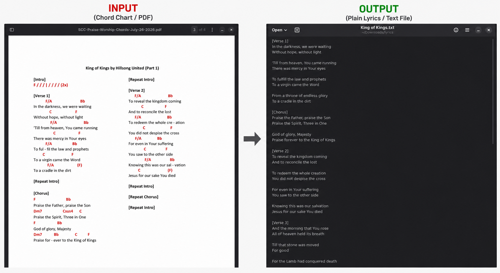
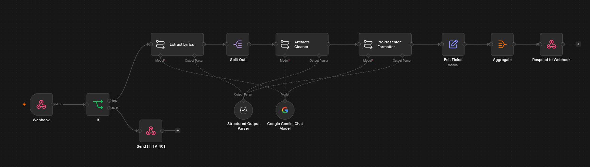

## What changed

Every week, volunteers at Solace of Christ Church (SCC) turn chord-chart PDFs into lyrics for ProPresenter, the software that puts words on the screen during Sunday service. They used to do it by hand, song by song. Now they paste in the chord chart or upload the PDF, and get back every song cleaned up, split into verses and choruses, and named, ready to download one at a time or as a zip.

That's **10+ minutes saved per song**, which adds up to hours every month for a team of volunteers giving up their own time.

## The problem

By hand, every song meant opening the PDF, copying the lyrics out, stripping the chord symbols, splitting verses and choruses, and reformatting it all for ProPresenter. Then doing it again for the next song, every week.

My first version of this tool helped, but watching volunteers use it showed me where it fell short:

* They had to tell it whether a file held one song or one song per page, which wasn't always obvious from the document.
* A wrong choice produced garbled output, with no clue what went wrong.
* It felt like a generic upload form, not something built for their Sunday routine.
* Getting several songs back meant repeating the whole upload-and-download cycle for each one.

## What I built

A page made just for SCC, behind an access code. It already knows their chord-chart format, so nobody has to think about how a file is structured. Paste or upload, then download. That's the whole job now.

## Goals

This version set out to:

* Remove the need for volunteers to classify their own input.
* Give SCC a dedicated, purpose-built page instead of a generic upload form.
* Restrict access to SCC members only, since the tool is tailored to their specific chord chart format.
* Return each song as a properly named, individually downloadable file, plus a zip of the full set.
* Simplify the backend workflow so it's easier to maintain and extend.

## How it works

Instead of asking users to upload a PDF and guess at its structure, the new page has them paste the extracted chord chart text directly. Text extraction from the PDF now happens client-side in the browser, so the app always receives plain text and never has to guess how the source file was structured.

That text is sent to an n8n workflow that runs it through a multi-step LLM chain: grouping the raw text into individual songs, cleaning up chord and formatting artifacts, and converting each song into ProPresenter-ready format. The formatted songs are returned to the page, each with an auto-generated file name, so volunteers can grab a single song or download everything at once as a zip.

The page itself is gated behind an access code, since it's built specifically for SCC's chord chart format and isn't meant for general public use.

### Under the hood

#### The formatting workflow

1. A webhook receives the extracted chord chart text from the client-facing page, along with the signature header.
2. An `If` node validates the access code; requests that fail validation get a `401` response and stop there.
3. An LLM call (Extract Lyrics) identifies and groups the raw text into individual songs.
4. `Split Out` breaks the grouped result into one item per song so each is processed independently downstream.
5. An LLM call (Artifacts Cleaner) strips chord symbols, stray whitespace, and other formatting artifacts from each song.
6. An LLM call (ProPresenter Formatter) converts the cleaned lyrics into ProPresenter-ready structure.
7. `Edit Fields` assigns each song a proper file name.
8. `Aggregate` collects all formatted songs back into a single response.
9. `Respond to Webhook` returns the finished set to the page for individual or zipped download.

## Challenges

The main challenge was rethinking where responsibility for extraction should live. The first version tried to handle every kind of PDF layout inside the n8n workflow itself, which is what led to the confusing "one song per file vs. one song per page" toggle in the first place.

For this version, I moved text extraction out of n8n and into a dedicated client-facing app, so the workflow only ever deals with plain text. This simplified the n8n side considerably, but it meant designing the client app to reliably extract text from SCC's specific chord chart PDFs before handing it off. Splitting the responsibility this way took a few iterations to get right, but it made both halves of the system simpler than trying to handle everything in one place.

## Lessons Learned

Watching real users struggle with the first version reinforced that user experience isn't something to bolt on after the workflow is built, it should shape the workflow itself. Prioritizing UX led me to restructure the whole pipeline: moving extraction to a dedicated client app, gating access, and returning properly named, individually downloadable files. The result wasn't just a friendlier interface, it was a genuinely simpler and more maintainable system.