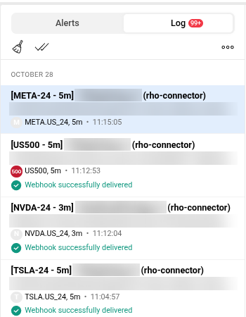
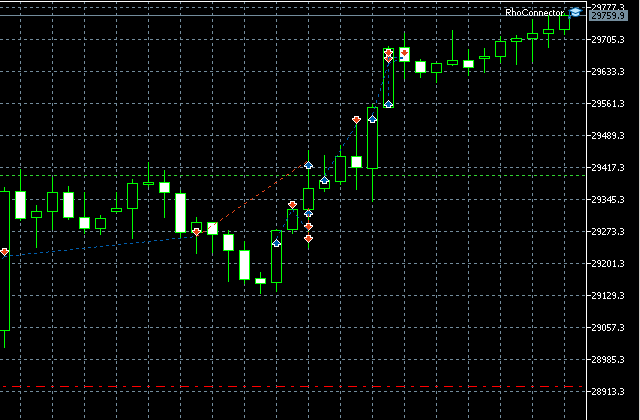
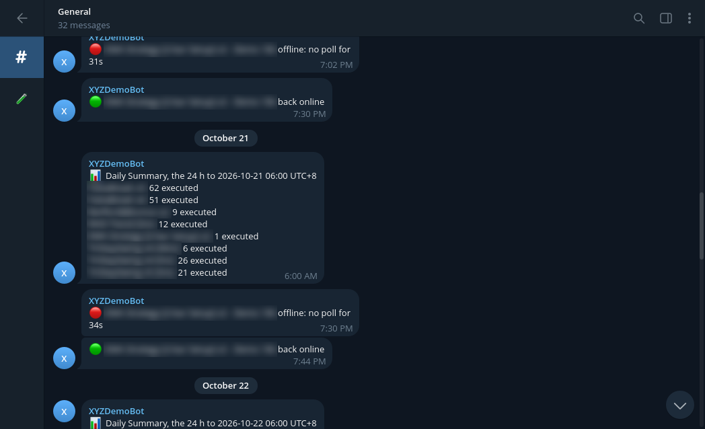

## Where they started

Robin Ho's team builds trading algorithms that traders subscribe to. Its strategies run in TradingView, and trades go through MetaTrader 5 (MT5). Before a strategy goes live, the team tests it on MT5 demo accounts, and they want to test as many strategies at once as they can. Something has to turn each alert into an MT5 order, and they were paying PineConnector to do it.

That plan capped them at 10 accounts, which capped how much they could test. And if an MT5 terminal went quiet, nobody knew until an expected trade didn't happen.

## What I built

Their own bridge from TradingView to MT5, called rho-connector, built as part of my ongoing work with the team:

- **No account cap.** TradingView alerts become MT5 orders on as many accounts as they want to run.
- **Alerts when something goes wrong.** The team hears about it when an MT5 terminal goes down, or when an alert fires and MT5 doesn't act on it.
- **One dashboard.** Every account in one place, with the strategies running on each and a log of every alert: the trade it placed, whether MT5 executed or skipped it, and how long it took.

*In TradingView, each strategy alert goes out to rho-connector as a webhook, and TradingView confirms it was delivered. Strategy names and keys are blurred.*

*In MT5, rho-connector runs as an Expert Advisor (top right) and places the trades marked on the chart. This is a demo account, where the team tests strategies before they go live.*

*The team gets a Telegram message when a terminal stops responding and again when it's back, plus a daily count of trades per strategy.*

## Where it is now

It's just been handed over, and the team is using it to test strategies on demo accounts. A fuller write-up will follow once they've lived with it for a while and shared their review.
