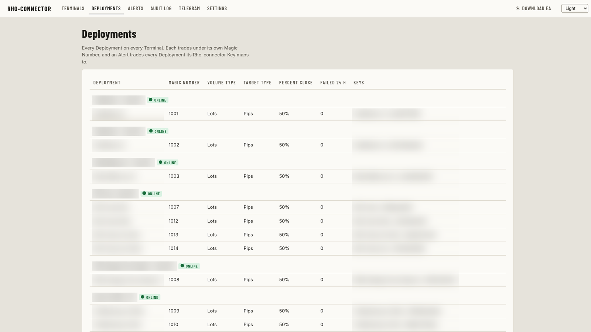
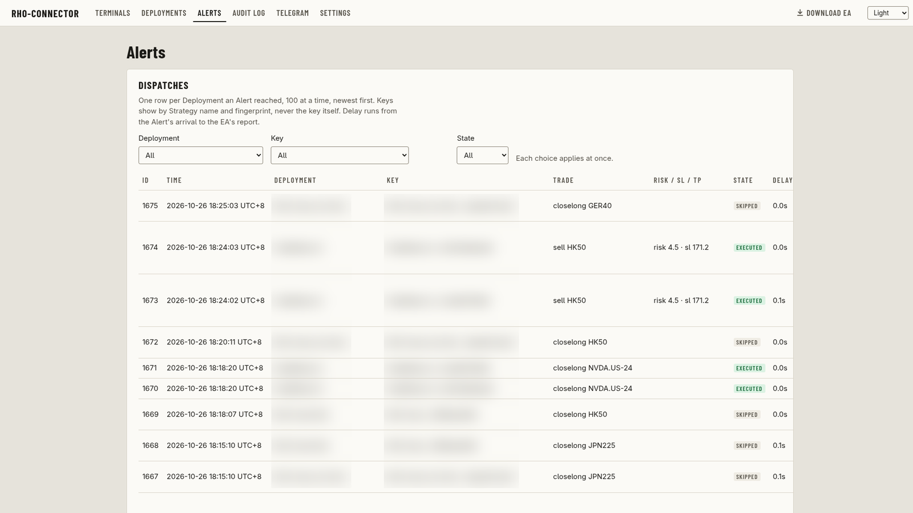
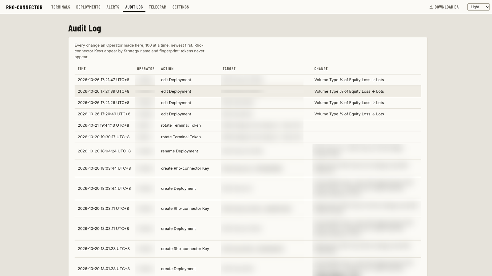

## Where they started

Robin Ho's team builds trading algorithms that traders subscribe to. Its strategies run in TradingView, and trades go through MetaTrader 5 (MT5) on the team's own accounts. Something has to turn each alert into an MT5 order, and they were paying PineConnector to do it.

That plan capped them at 10 accounts. And if an MT5 terminal went quiet, nobody knew until an expected trade didn't happen.

## What I built

Their own bridge from TradingView to MT5, called rho-connector, built as part of my ongoing work with the team:

- **No account cap.** TradingView alerts become MT5 orders on as many accounts as they want to run.
- **Alerts when something goes wrong.** The team hears about it when an MT5 terminal goes down, or when an alert fires and MT5 doesn't act on it.
- **One dashboard.** Every account in one place, with the alerts and strategies running on each.

## Where it is now

It's just been handed over. A fuller write-up will follow once the team has lived with it for a while and shared their review.
